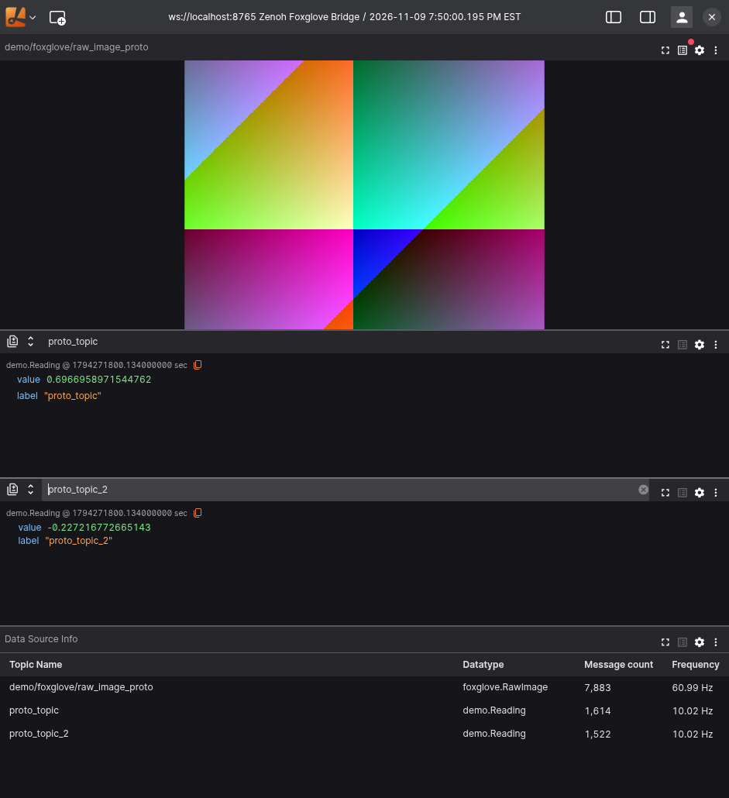

# Zenoh Foxglove Bridge

Stream Zenoh messages to Foxglove Studio and Lichtblick through a read-only WebSocket server. Run the bridge as a standalone Rust executable or load it as a `zenohd` plugin.

The bridge supports Protobuf, JSON, plain text, and raw byte payloads. It advertises topics as messages arrive and uses the Foxglove SDK WebSocket protocol (`foxglove.sdk.v1`). By default, it subscribes to all Zenoh topics (`**`) and serves viewers at `ws://127.0.0.1:8765`.



## Requirements

- A Rust toolchain with support for edition 2024 and Cargo.
- Foxglove Studio or a Lichtblick release that supports `foxglove.sdk.v1`.
- For plugin mode, `zenohd` 1.10.1 with a compatible Rust toolchain.
- For generating Protobuf descriptor files, the Protocol Buffers compiler (`protoc`). The basic demo provides descriptors without requiring `protoc`.

## Build and run

Run the following commands from the repository root:

```sh
cargo build --release --locked
./target/release/zenoh-foxglove-bridge
```

The standalone bridge uses Zenoh's default peer discovery. To connect to a router at `tcp/127.0.0.1:7447`, use the included client configuration:

```sh
./target/release/zenoh-foxglove-bridge --config config/bridge.json --zenoh-config config/client.json5
```

In Foxglove Studio or Lichtblick, open a **Foxglove WebSocket** connection to `ws://127.0.0.1:8765`. Add a Raw Messages panel to inspect messages, or a Plot panel to plot numeric fields. Custom Protobuf messages appear by their field names; specialized 3D panels require compatible message schemas.

For remote viewers, set `bind` to the host's interface or `0.0.0.0`, then connect using that host's address. The server is read-only and provides no authentication or TLS; the default binding is loopback.

## Run as a zenohd plugin

The same build produces `target/release/libzenoh_plugin_foxglove.so` on Linux (`.dylib` on macOS, `.dll` on Windows). Use a **Zenoh 1.10.1** router. The router and plugin must use compatible Rust toolchains and matching Zenoh feature sets; Zenoh checks compatibility on load.

If the router enables Zenoh's `shared-memory` feature, enable it when building the plugin as well:

```sh
cargo build --release --locked --features zenoh/shared-memory
```

A `Plugin compatibility mismatch` error lists the router's (`host`) and plugin's feature sets. Match those features before loading the plugin.

```sh
zenohd -c config/zenohd.json5
```

Run this from the repository root, or change `plugins.foxglove.__path__` to the absolute library path. The example router listens at `tcp/127.0.0.1:7447`. Plugin settings are directly under `plugins.foxglove`; they have the same names as `config/bridge.json`. The plugin shares the router's runtime and shuts down its server and tasks when unloaded. Restart the plugin to apply bridge setting changes. Run either the standalone server or plugin on a given WebSocket port.

## Protobuf support

### Descriptor discovery

By default, each Protobuf publisher must expose a Zenoh queryable on `<topic>/protobuf_descriptor`. For example, a publisher on `sensors/temperature` exposes its descriptor at `sensors/temperature/protobuf_descriptor`.

Reply on that same key with the raw binary **`google.protobuf.FileDescriptorSet`**, including imported files. Do not send `.proto` source text, base64 text, or a single `FileDescriptorProto`. The bridge queries the descriptor, advertises a `protobuf` channel with the descriptor as its schema, and forwards the original message bytes. The SDK handles WebSocket schema base64 encoding. This follows [Foxglove's Protobuf schema format](https://docs.foxglove.dev/docs/getting-started/custom/custom-schema-encodings).


### Shared descriptor file

For publishers that do not expose a descriptor queryable, provide one shared descriptor set containing all message types.  

Generate a descriptor with:

```sh
protoc --include_imports --descriptor_set_out=descriptor.bin --proto_path=. your_message.proto
```

Run with the descriptor file:

```sh
./target/release/zenoh-foxglove-bridge --descriptor-file /path/to/descriptor.bin
```

The equivalent configuration setting, which also works for the `zenohd` plugin, is:

```json
{
  "descriptor_file": "/path/to/descriptor.bin"
}
```

The file must contain the raw binary `FileDescriptorSet` described above and may contain any number of message types and imported `.proto` files. It is read once when the bridge starts and takes precedence over descriptor queries for every Protobuf topic. Relative paths are resolved from the bridge process's working directory.

### Message type selection

The bridge selects the Protobuf message name in this order:

1. An explicit `message_types` entry for the topic.
2. The data sample's `application/protobuf` encoding schema.
3. The descriptor reply's `application/protobuf` encoding schema.
4. Inference when there is exactly one top-level message in the root descriptor files (files not imported by another file).

Publish the fully qualified name as Zenoh encoding metadata to support automatic discovery even when the descriptor contains multiple message types:

```rust
.encoding(zenoh::bytes::Encoding::APPLICATION_PROTOBUF.with_schema("example.msg.basic.Basic"))
```

The encoding schema lets the bridge automatically select the matching type from a shared descriptor containing many messages. When queryable discovery is used, the queryable still returns the binary `FileDescriptorSet`. Empty encoding schemas fall back to inference. Names supplied through metadata must exist in the descriptor, just like configured names. For publishers without type metadata, or to override an exceptional topic, configure the actual type explicitly:

```json
{
  "message_types": {
    "sensors/temperature": "example.Temperature",
    "sensors/pressure": "example.Pressure"
  }
}
```

Configured types must exist in the descriptor; nested message names are supported. Protobuf publishers must set the Zenoh message encoding to `application/protobuf` or have their topic listed in `message_types`; otherwise the payload is intentionally treated as raw bytes. Descriptor keys are metadata and are not advertised as data channels.

### Descriptor updates and failures

Missing, malformed, or ambiguous queried descriptors generate a warning and are retried when subsequent messages arrive after `retry_interval_ms`. Established queried Protobuf topics are also refreshed at that interval while messages are arriving. If the publisher's descriptor changes, the bridge unadvertises the old Foxglove channel and advertises a new one; a failed refresh keeps the last known-good channel active. Configured descriptor files that cannot be read or exceed `max_message_bytes` prevent bridge startup; malformed or ambiguous configured contents are reported when the topic first publishes. Descriptor files are read once at startup and are not refreshed. The first message is held while a descriptor is queried; bounded queues buffer further messages.

## Supported payloads

| Data type | Zenoh encoding | Viewer representation | Requirements and behavior |
| --- | --- | --- | --- |
| Protobuf | `application/protobuf`, or any topic listed in `message_types` | Protobuf channel with the original message bytes and the selected message schema | Requires a binary `FileDescriptorSet` from a descriptor queryable or shared descriptor file. See [Protobuf support](#protobuf-support). |
| JSON object | `application/json` or `text/json` | JSON channel with a permissive object schema | Schema name comes from encoding metadata and defaults to `json`. Invalid JSON and non-object values are dropped. |
| Raw image (JSON) | `application/json` or `text/json` with schema name `foxglove.RawImage` | JSON channel with the built-in `foxglove.RawImage` schema for Image panels | Payload must follow the image schema. See [Image rendering](#image-rendering) for JSON and Protobuf examples. |
| Plain text | `text/plain` | JSON object with the original string in `data`; schema name `text` | Requires valid UTF-8; invalid UTF-8 payloads are dropped. |
| Raw bytes | All other encodings, including Zenoh's default byte encoding | `Zenoh.RawBytes` JSON envelope with an `encoding` string, a `data` byte array, and a lowercase `hex` string | Preserves the exact payload bytes for inspection in a Raw Messages panel. |

## Configuration and resource limits

[`config/bridge.json`](config/bridge.json) lists all bridge settings. `key_expr` selects topics using a Zenoh key expression. `descriptor_file` supplies one shared descriptor set for Protobuf topics. Descriptor queries time out after `query_timeout_ms`; `retry_interval_ms` controls both failed discovery retries and successful queried-descriptor refreshes. Each topic has an independent worker and `queue_capacity` pending messages, so a missing descriptor does not block other topics. Full topic queues drop new arrivals (logged at debug level). `max_topics` bounds the number of tracked topics; `max_message_bytes` limits payload and descriptor sizes. Channels remain registered until shutdown unless a queried Protobuf descriptor changes. These are live streams: there is no history replay, and messages sent before a viewer subscribes are not retained for it.

Zenoh timestamps are preserved when present; otherwise the bridge uses its receive time. Set `RUST_LOG=debug` for standalone diagnostics. The plugin uses the router's logging configuration.

## Examples

### Protobuf with descriptor discovery

Run the bridge and demo publisher in separate terminals. The publisher sends `demo.Reading` messages on `proto_topic` and `proto_topic_2` and serves their descriptors:

```sh
# Terminal 1:
cargo run --bin zenoh-foxglove-bridge
# Terminal 2:
cargo run --example protobuf_publisher
# With the example router instead:
cargo run --example protobuf_publisher -- config/client.json5
```

Connect a viewer to `ws://127.0.0.1:8765` and select either topic in a Raw Messages or Plot panel.

### Protobuf with a shared descriptor file

Generate the descriptor before starting the bridge, then run the bridge and publisher in separate terminals:

```sh
protoc --include_imports --descriptor_set_out=descriptor.bin \
  --proto_path=examples examples/reading.proto
# Terminal 1:
cargo run --bin zenoh-foxglove-bridge -- --descriptor-file descriptor.bin
# Terminal 2:
cargo run --example protobuf_publisher_no_queryable
# With the example router, append: -- config/client.json5
```

### Image rendering

To demonstrate image rendering with Foxglove's JSON `RawImage` schema, run the bridge and this publisher in separate terminals:

```sh
cargo run --example raw_image_json_publisher
# With the example router:
cargo run --example raw_image_json_publisher -- config/client.json5
```

The example publishes a moving RGB image on `demo/foxglove/raw_image`. Add that topic to Lichtblick's Image panel. Its Zenoh encoding includes the `foxglove.RawImage` schema name, allowing the bridge to advertise the recognized datatype instead of generic `json`.

The equivalent Protobuf example publishes on `demo/foxglove/raw_image_proto` and provides the canonical descriptor through a Zenoh queryable:

```sh
cargo run --example raw_image_protobuf_publisher
# With the example router:
cargo run --example raw_image_protobuf_publisher -- config/client.json5
```

## Development and testing

Run the automated tests with:

```sh
cargo test --locked
```

The integration test uses an isolated Zenoh session and a real Foxglove SDK WebSocket client to check schema advertisements, descriptor retrieval, exact message bytes, timestamps, JSON forwarding, late descriptors, and shutdown.

To test the built executable and dynamically loaded plugin against an installed `zenohd` 1.10.1, run:

```sh
cargo build --locked --bins --lib --examples
python3 tests/runtime_smoke.py
```

If plugin mode reports a feature mismatch because the installed router enables `zenoh/shared-memory`, rebuild the debug artifacts and rerun:

```sh
cargo build --locked --bins --lib --examples --features zenoh/shared-memory
python3 tests/runtime_smoke.py
```

The script uses `target/debug` by default. To test release artifacts, build with `--release` and run `python3 tests/runtime_smoke.py target/release`.

This process-level smoke test starts isolated local routers, publishes both demo topics with their descriptor queryables, and verifies receipt through each WebSocket server.

## License

Licensed under either the [MIT License](LICENSE-MIT) or the [Apache License, Version 2.0](LICENSE-APACHE), at your option.
